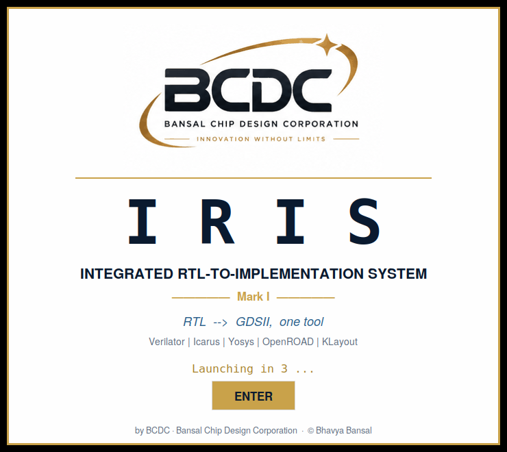
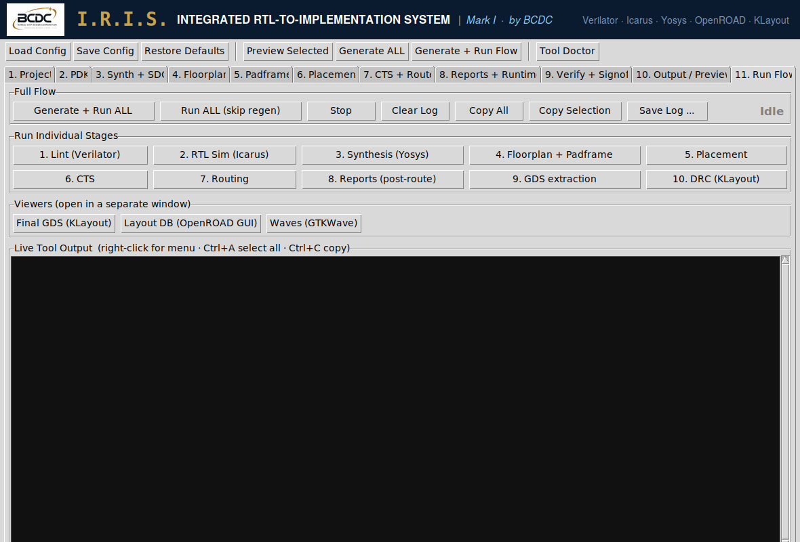
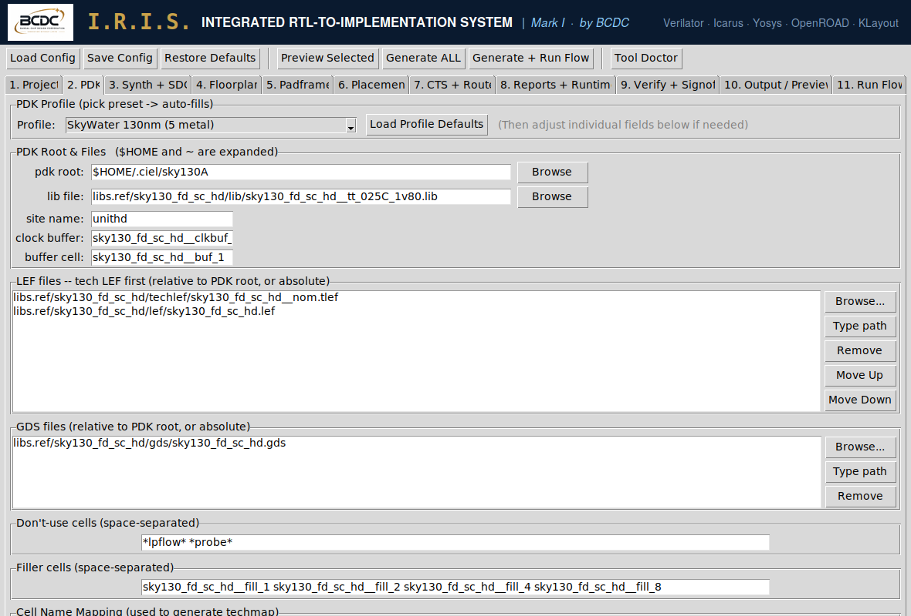
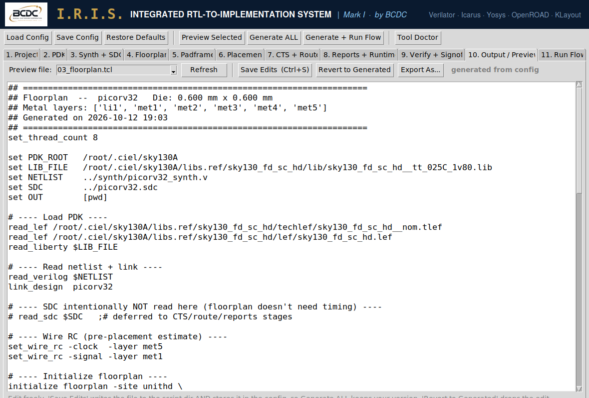

<p align="center">
  
</p>

<h1 align="center">I.R.I.S. — Integrated RTL-to-Implementation System</h1>
<p align="center"><b>Mark I</b> · by BCDC (Bansal Chip Design Corporation)</p>
<p align="center">One installer and one GUI for the complete open-source RTL → GDSII flow:<br>
Verilator · Icarus · Yosys · OpenROAD · KLayout · Magic · Netgen · GTKWave</p>

---

Open-source chip design tools are excellent. Running them is not: each tool has its own install, environment and terminal, and every OpenROAD release renames options. **IRIS** wraps the whole flow in one place:

- **One installer** (`install_iris.sh`) sets up a pinned toolchain from nixpkgs. Every machine that uses the same pin gets identical tool versions.
- **One GUI** (or `iris run` from the command line) runs lint → simulation → synthesis → floorplan → placement → CTS → routing → reports → GDS → DRC.
- **One config file** (`.json`) describes the design, the PDK and every flow setting. It's shareable and version-controllable.
- **Viewers built in:** final GDS in KLayout, the layout database in the OpenROAD GUI, and waveforms in GTKWave.

<p align="center"></p>

## Status

**Mark I is early.** The full flow has been run on [picorv32](https://github.com/YosysHQ/picorv32) on SkyWater sky130 (about 6k cells, 0 router DRC violations, setup met at 50 MHz). It's a working tool, not yet a sign-off flow. See [Roadmap](#roadmap) for what's missing.

## Install

Linux, or WSL2 on Windows. x86_64 or aarch64, about 8 GB disk.

```bash
git clone https://github.com/BhavyaBansal26/iris-eda.git
cd iris-eda
bash install_iris.sh            # options: --analog  --oss-cad-suite  --apt-klayout
source ~/.bashrc
iris doctor                     # every tool + version
iris                            # launch the GUI
```

The installer:

1. Installs a few apt packages (`python3-tk` and friends).
2. Installs [Nix](https://nixos.org) in single-user mode if you don't already have it.
3. Builds the toolchain from **one pinned nixpkgs release**, downloaded from releases.nixos.org (no GitHub API rate limits).
4. Installs the `iris` command.

Re-running it is safe. Nothing touches your system Python or your other tools.

## Quick start: picorv32 on sky130

```bash
pip3 install --user ciel && ciel enable --pdk-family sky130 <hash>   # sky130A PDK (or use volare)
git clone https://github.com/YosysHQ/picorv32 ~/designs/picorv32
mkdir -p ~/iris_runs/picorv32
cp examples/picorv32/* ~/iris_runs/picorv32/
cd ~/iris_runs/picorv32
iris run picorv32_sky130.json --stages lint,sim,synth      # quick check
iris run picorv32_sky130.json                               # full flow to GDS
iris view work/gds/picorv32_final.gds
```

Or open the GUI with `iris gui picorv32_sky130.json`, then go to **Run Flow** → **Generate + Run ALL**.

| | |
|---|---|
|  |  |
| **Run Flow:** one button per stage, a live log, and viewers | **PDK:** profiles, plus Browse buttons for LEF / lib / GDS |



**Output / Preview:** every generated script can be edited and saved. Edited scripts are locked, so **Generate ALL** keeps your version until you choose **Revert to Generated**.

## Commands

```
iris [gui] [cfg.json]       GUI
iris run cfg.json           headless flow  (--stages lint,sim,synth,floorplan,place,cts,route,reports,gds,drc)
iris gen cfg.json --out D   generate scripts only (also writes a standalone run_flow.sh)
iris doctor                 check tools + versions
iris shell                  bash with the whole toolchain on PATH
iris view file.gds          KLayout
iris update | rollback      move to a newer nixpkgs release / undo it
iris release [DIR]          small shareable bundle with version pins
iris pack [DIR]             offline bundle (install with install_iris.sh --offline DIR)
```

## PDKs

These profiles are built in: **SkyWater sky130** (hd), **GF180MCU**, and **Custom** (fill in your own values).

**Proprietary or NDA PDKs are never committed.** Put their profiles in a private file that IRIS loads at start-up:

```
~/.bcdc/pdk_profiles.local.json        (or set IRIS_PDK_PROFILES=/path/to/file.json)
```

See [`docs/pdk_profiles.local.example.json`](docs/pdk_profiles.local.example.json) for the format. Flops can be mapped with Yosys `dfflibmap` (any liberty) or with a manual techmap whose cell and pin names come from the profile.

## How it works

`iris.py` generates plain, readable scripts and then runs them:

| File | Tool |
|---|---|
| `01_synth.ys`, `dff_map.v`, `latch_map.v` | Yosys |
| `02_design.sdc` | timing constraints |
| `03_floorplan.tcl` … `08_reports.tcl` | OpenROAD (floorplan + tapcells + PDN, placement, CTS + hold repair, routing, post-route reports) |
| `09_gds_merge.py` | KLayout DEF → GDS |
| `10_view.tcl` | OpenROAD GUI loader |
| `run_flow.sh` | the same flow without the GUI |

Every stage re-reads the timing library, because `.odb` files don't store it. A stage that crashes after writing its output (for example a CTS segfault) is allowed to continue only if that file was written during the current run.


## License

IRIS is **GPL-3.0-or-later**; see [LICENSE](LICENSE). © Bhavya Bansal / BCDC.

IRIS calls the tools it wraps as separate programs and does not bundle them. Each tool keeps its own license; see [THIRD_PARTY.md](THIRD_PARTY.md).

**Commercial support, training and custom PDK enablement** are available from BCDC. Open an issue or reach out via GitHub.

*"IRIS" here refers to this project only. It is not affiliated with Intel® Iris® graphics or any other product of that name.*
